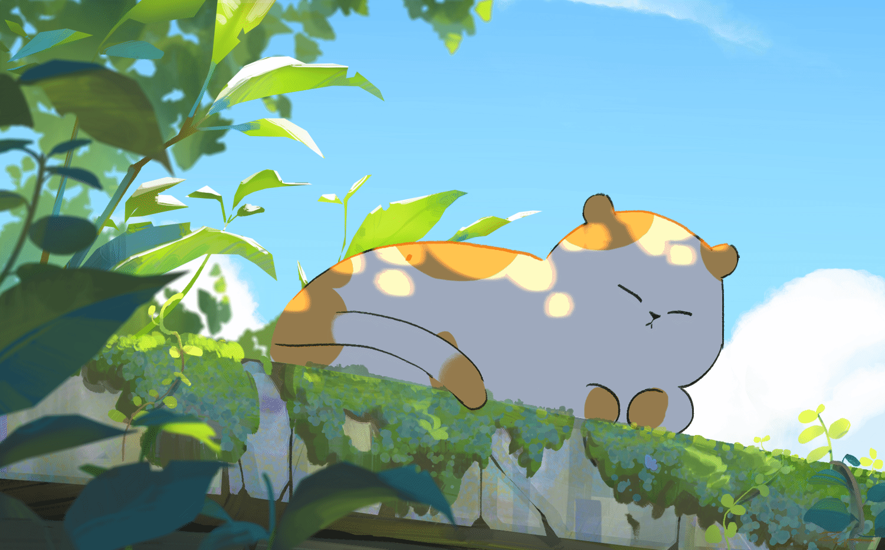

  

# Hi, I'm Nikhil!

> A little bit of systems. A little bit of strings. A lot of curiosity.

I'm a software engineer drawn to **backend engineering and systems development**. I like taking things apart, understanding how they work, and building things worth keeping.

When I'm not coding, I'm probably making music, solving puzzles, or wandering somewhere unfamiliar. I have a soft spot for quiet moments and good conversations.

### Things I've worked on.

-  - An in-memory database built from scratch in C.
-  - A modular HTTP load balancer in Go.
-  - A URL-shortening platform built with Go and distributed services.
-  - A tiny virtual machine brought to life in C.

### Languages I write.

`C` · `C++` · `Go` · `TypeScript` · `Python`

And also `Markdown` for robot.

Backend systems, infrastructure, Linux, databases, and the occasional rabbit hole.

### Things I do in free time.

Classical guitar, chess, Rubik's Cubes, photography, and exploring unfamiliar places. Currently trying to make friends with a few pieces by **Francisco Tárrega.**

> Always happy to meet curious minds, exchange ideas, and build something interesting.

 ·  · 

Made with curiosity, a little stubbornness, and probably too much coffee.
